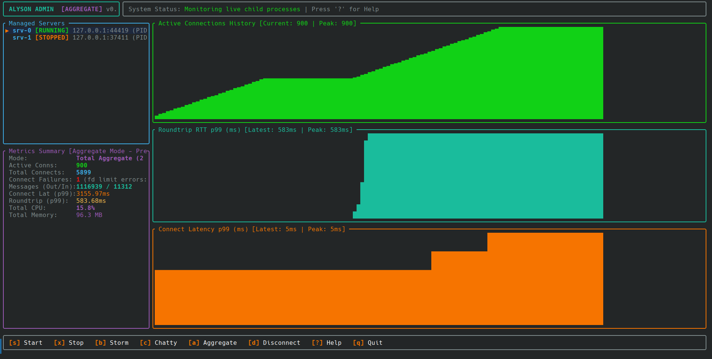

# Alyson

A terminal-native chat system and real-time TCP load testing workbench written in Rust.



Alyson combines a multi-room messaging server and client with an in-terminal admin workbench. You can chat with other users across rooms, or switch to the admin dashboard to spin up child servers, flood them with hundreds of headless bots, and graph connection latency and process resources in real time.

---

## Why I Built This

I wanted to build a real-time messaging system from scratch to understand three things deeply:
1. **Custom binary framing over raw TCP:** Length-prefixed framing with Bincode instead of relying on HTTP or WebSockets.
2. **Async socket multiplexing:** Coordinating hundreds of client streams using Tokio tasks, channels, and SQLite in WAL mode.
3. **Terminal user interfaces:** Building flicker-free, responsive dashboards with Ratatui and Crossterm.

Along the way, verifying concurrency by manually opening 10 terminal windows got old fast. So I built `alyson-admin`: a dedicated load-testing harness that spins up server processes on ephemeral ports, ramps up connect-storms, fires active chat probes to calculate true round-trip latency (RTT) percentiles with HdrHistogram, and graphs everything live using ASCII sparklines.

---

## Features

- **Terminal Chat Client:** Multi-room chat, private direct messaging, speech bubbles, roster sidebar, and persistent history backed by SQLite.
- **Dedicated TCP Server:** Non-blocking Tokio accept loop, length-prefixed binary wire framing, and SQLite in WAL mode for concurrent multi-process reads.
- **Admin Workbench (`alyson-admin`):**
  - **Process Supervision:** Launch, monitor, and cleanly terminate child server processes (`SIGTERM` -> `SIGKILL`).
  - **Connect-Storm Ramping:** Launch hundreds of headless clients at configurable connection rates (e.g. 50/sec) and hold connections open.
  - **Active Chatty Probes:** Headless bots send periodic chat messages and measure true end-to-end round-trip echo latency.
  - **Telemetry & Percentiles:** Microsecond-precision `HdrHistogram` percentiles (p50, p90, p99, p99.9), live CPU% and RSS memory sampling via `sysinfo`.
  - **Ratatui Dashboard:** Live ASCII sparklines for CPU, memory, and active connections, server switcher, help screen overlay, and multi-server aggregate views.

---

## Quickstart

### Prerequisites

- [Rust 1.75+](https://www.rust-lang.org/tools/install)
- A terminal with at least 80x24 dimensions

Clone and build:
```bash
git clone https://github.com/mnasies/alyson.git
cd alyson
cargo build
```

### 1. Dev Mode (Server + Client in One Terminal)
Spawns an internal server on an OS-assigned port and immediately connects a TUI client:
```bash
cargo run
```

### 2. Standalone Server & Client
Start a dedicated TCP server listening on a port:
```bash
cargo run --bin server -- serve 127.0.0.1:9000
```

In another terminal, connect a chat client:
```bash
cargo run --bin client -- connect 127.0.0.1:9000 --name Alice
```

### 3. Admin & Load Testing Dashboard
Launch the interactive monitoring dashboard:
```bash
cargo run --bin admin
```

---

## Admin Workbench & Load Testing

The `alyson-admin` binary is both an interactive TUI dashboard and a CLI load-testing tool.

### Interactive TUI Keybindings

When running `cargo run --bin admin`:

| Key | Action | Description |
|---|---|---|
| `s` | **Start Server** | Prompts for bind address (e.g. `127.0.0.1:0` for ephemeral port) and spawns child server process. |
| `b` | **Connect-Storm** | Prompts for `<count> [rate]`. Ramps up $N$ clients at rate/sec and holds them open. |
| `c` | **Chatty Batch** | Prompts for `<count> [rate]`. Clients connect and send periodic chat messages, measuring RTT. |
| `m` | **Multi-Server Batch** | Evenly distributes a batch across all running child server processes. |
| `d` | **Disconnect Batch** | Disconnects all client batches targeting the selected server. |
| `x` | **Stop Server** | Sends `SIGTERM` (5s graceful timeout -> `SIGKILL`) to the selected child server. |
| `a` | **Aggregate Mode** | Toggles multi-server summary mode (sums connections, messages, CPU/RSS across all servers). |
| `↑` / `↓`, `k` / `j` | **Select Server** | Switches active inspection target between managed child servers. |
| `?` / `h` | **Help Overlay** | Toggles the help and keybinding modal window. |
| `q` / `Esc` | **Quit** | Shuts down all child server processes cleanly and exits to shell. |

### Headless CLI Load Testing

For automated benchmarks, headless load tests can run without the TUI:

```bash
# Run a 200-client connection storm at 50 connects/sec:
cargo run --bin admin -- storm 127.0.0.1:9000 200 50

# Run a 50-client chatty messaging test at 25 connects/sec:
cargo run --bin admin -- chatty 127.0.0.1:9000 50 25
```

Both subcommands print live 1-second progress lines and a final summary:
```text
[ 10.0s] active: 50   tot: 50   fail: 0  (fd: 0) | msgs out/in: 250/250 | conn p99: 1.2ms | rtt p99: 3.4ms | CPU: 12.5% | RSS: 18.2MB

📊 Chatty (Active Messaging) Finished. Summary:
   • Active connections: 50
   • Total connected:    50
   • Connect failures:   0 (fd limit: 0)
   • Messages Sent:      250
   • Messages Received:  250
   • Connect Latency:    p50: 820µs | p99: 1.2ms
   • Roundtrip Latency:  p50: 1.4ms | p99: 3.4ms
   • Process Resources:  CPU: 12.5% | RSS: 18.2MB
```
