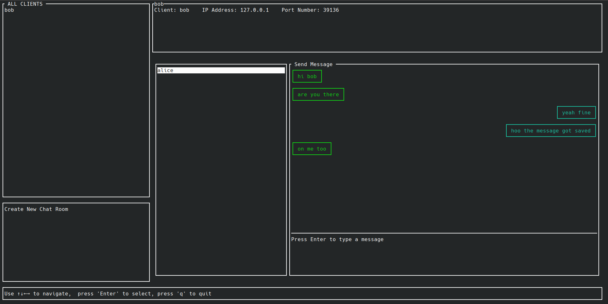
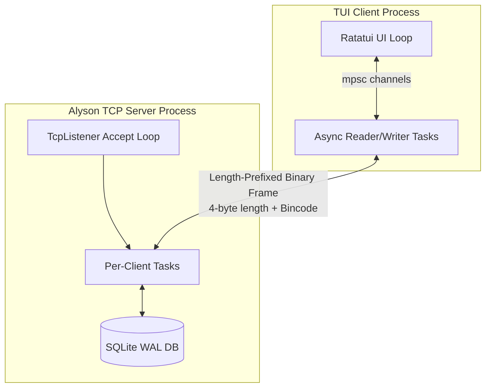
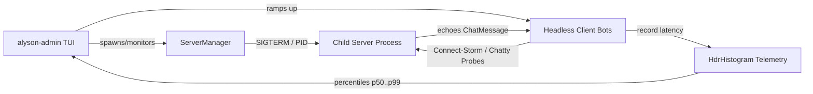

# Alyson

A terminal-native chat system and real-time TCP load testing workbench written in Rust.


Alyson combines a multi-room messaging server and client with an in-terminal admin workbench. You can chat with other users across rooms, or switch to the admin dashboard to spin up child servers, flood them with hundreds of headless bots, and graph connection latency and process resources in real time.

---

## Why I Built This

I wanted to build a real-time messaging system from scratch to understand three things deeply:
1. **Custom binary framing over raw TCP:** Length-prefixed framing with Bincode instead of relying on HTTP or WebSockets.
2. **Async socket multiplexing:** Coordinating hundreds of client streams using Tokio tasks, channels, and SQLite in WAL mode.
3. **Terminal user interfaces:** Building flicker-free, responsive dashboards with Ratatui and Crossterm.

Along the way, verifying concurrency by manually opening 10 terminal windows got old fast. So I built `alyson-admin`: a dedicated load-testing harness that spins up server processes on ephemeral ports, ramps up connect-storms, fires active chat probes to calculate true round-trip latency (RTT) percentiles with HdrHistogram, and graphs everything live using ASCII sparklines.

---

## Features

- **Terminal Chat Client:** Multi-room chat, private direct messaging, speech bubbles, roster sidebar, and persistent history backed by SQLite.
- **Dedicated TCP Server:** Non-blocking Tokio accept loop, length-prefixed binary wire framing, and SQLite in WAL mode for concurrent multi-process reads.
- **Admin Workbench (`alyson-admin`):**
  - **Process Supervision:** Launch, monitor, and cleanly terminate child server processes (`SIGTERM` -> `SIGKILL`).
  - **Connect-Storm Ramping:** Launch hundreds of headless clients at configurable connection rates (e.g. 50/sec) and hold connections open.
  - **Active Chatty Probes:** Headless bots send periodic chat messages and measure true end-to-end round-trip echo latency.
  - **Telemetry & Percentiles:** Microsecond-precision `HdrHistogram` percentiles (p50, p90, p99, p99.9), live CPU% and RSS memory sampling via `sysinfo`.
  - **Ratatui Dashboard:** Live ASCII sparklines for CPU, memory, and active connections, server switcher, help screen overlay, and multi-server aggregate views.

---

## Quickstart

### Prerequisites

- [Rust 1.75+](https://www.rust-lang.org/tools/install)
- A terminal with at least 80x24 dimensions

Clone and build:
```bash
git clone https://github.com/mnasies/alyson.git
cd alyson
cargo build
```

### 1. Dev Mode (Server + Client in One Terminal)
Spawns an internal server on an OS-assigned port and immediately connects a TUI client:
```bash
cargo run
```

### 2. Standalone Server & Client
Start a dedicated TCP server listening on a port:
```bash
cargo run --bin server -- serve 127.0.0.1:9000
```

In another terminal, connect a chat client:
```bash
cargo run --bin client -- connect 127.0.0.1:9000 --name Alice
```

### 3. Admin & Load Testing Dashboard
Launch the interactive monitoring dashboard:
```bash
cargo run --bin admin
```

---

## Admin Workbench & Load Testing

The `alyson-admin` binary is both an interactive TUI dashboard and a CLI load-testing tool.

### Interactive TUI Keybindings

When running `cargo run --bin admin`:

| Key | Action | Description |
|---|---|---|
| `s` | **Start Server** | Prompts for bind address (e.g. `127.0.0.1:0` for ephemeral port) and spawns child server process. |
| `b` | **Connect-Storm** | Prompts for `<count> [rate]`. Ramps up $N$ clients at rate/sec and holds them open. |
| `c` | **Chatty Batch** | Prompts for `<count> [rate]`. Clients connect and send periodic chat messages, measuring RTT. |
| `m` | **Multi-Server Batch** | Evenly distributes a batch across all running child server processes. |
| `d` | **Disconnect Batch** | Disconnects all client batches targeting the selected server. |
| `x` | **Stop Server** | Sends `SIGTERM` (5s graceful timeout -> `SIGKILL`) to the selected child server. |
| `a` | **Aggregate Mode** | Toggles multi-server summary mode (sums connections, messages, CPU/RSS across all servers). |
| `↑` / `↓`, `k` / `j` | **Select Server** | Switches active inspection target between managed child servers. |
| `?` / `h` | **Help Overlay** | Toggles the help and keybinding modal window. |
| `q` / `Esc` | **Quit** | Shuts down all child server processes cleanly and exits to shell. |

### Headless CLI Load Testing

For automated benchmarks, headless load tests can run without the TUI:

```bash
# Run a 200-client connection storm at 50 connects/sec:
cargo run --bin admin -- storm 127.0.0.1:9000 200 50

# Run a 50-client chatty messaging test at 25 connects/sec:
cargo run --bin admin -- chatty 127.0.0.1:9000 50 25
```

Both subcommands print live 1-second progress lines and a final summary:
```text
[ 10.0s] active: 50   tot: 50   fail: 0  (fd: 0) | msgs out/in: 250/250 | conn p99: 1.2ms | rtt p99: 3.4ms | CPU: 12.5% | RSS: 18.2MB

📊 Chatty (Active Messaging) Finished. Summary:
   • Active connections: 50
   • Total connected:    50
   • Connect failures:   0 (fd limit: 0)
   • Messages Sent:      250
   • Messages Received:  250
   • Connect Latency:    p50: 820µs | p99: 1.2ms
   • Roundtrip Latency:  p50: 1.4ms | p99: 3.4ms
   • Process Resources:  CPU: 12.5% | RSS: 18.2MB
```

---

## Chat Client TUI



The client connects over TCP, negotiates a username, and renders an interactive terminal chat interface with real-time room updates and message speech bubbles.

### Client Keybindings

| Key | Context | Action |
|---|---|---|
| `Tab` / `Shift+Tab` | Any | Cycle focus between Sidebar (users/rooms), Action pane, and Message Input. |
| `↑` / `↓` | Sidebar / Lists | Navigate room list or online users roster. |
| `Enter` | Input Box | Send current chat message to active room or peer. |
| `Enter` | Sidebar Item | Join selected room or open direct message channel. |
| `Esc` | Typing | Exit typing mode or clear current text buffer. |
| `PageUp` / `PageDown` | Chat Pane | Scroll message history up and down. |
| `q` | Normal Mode | Exit chat client and cleanly restore terminal settings. |

---

## How It Works

### Architecture Overview



### Admin Load Test Architecture



### Protocol & Wire Framing

Communication across sockets uses a two-phase protocol:

1. **Handshake Phase:**
   - The connecting client sends its UTF-8 username terminated by newline: `<username>\n`.
   - The server registers the client in SQLite, assigns a `u64` client ID, and replies with: `<client_id>\n`.

2. **Framing & Payload Phase:**
   Every message frame contains:
   - **Header:** A 4-byte big-endian unsigned integer (`u32`) indicating payload byte size.
   - **Payload:** Bincode-serialized `ClientRequest` or `ServerEvent` struct.
   - **Guard limit:** Payloads exceeding 10 MB are rejected before allocation to protect against socket flooding.

### Latency Measurement Mechanics

When running a `Chatty` load test, headless clients transmit a `ClientRequest::ChatMessage` containing a timestamp probe. When the server echoes this message back to the sender, the client measures elapsed time:
$$\text{RTT} = \text{SystemTime::now()} - \text{entry.time}$$
The duration is clamped and recorded into a pre-allocated `HdrHistogram` (1µs to 60s dynamic range, 3 significant digits). This yields true end-to-end percentiles without runtime heap reallocations.

---

## Development & Testing

### Verification Commands

Verify compilation across all library modules, binaries, and tests:
```bash
cargo check --tests --bins
```

Run the complete test suite:
```bash
cargo test
```

Run the dedicated `alyson-admin` integration test suite:
```bash
cargo test --test admin
```

### Integration Test Suite Coverage

The 12 integration tests in `tests/admin.rs` test:
- **`test_server_lifecycle`**: Spawning child processes on ephemeral ports, non-blocking address capture, and clean `SIGTERM`/`SIGKILL` shutdown.
- **`test_headless_client_connect_and_metrics`**: Single headless bot handshake, assigned ID validation, and metric counter decrements on disconnect.
- **`test_connect_storm_batch`**: Concurrently ramping 10 clients at 50/sec and verifying atomic connection summaries.
- **`test_histogram_latency_percentiles`**: Verifying p50 and p99 percentiles recorded into HdrHistogram against known synthetic distributions.
- **`test_rolling_history_buffer`**: Capacity eviction and FIFO ordering in fixed-size rolling history ring buffers.
- **`test_sysinfo_sampler_process_stats`**: Background process sampling verifying non-zero RSS memory tracking.
- **`test_admin_app_lifecycle_and_selection`**: Multi-server start, list navigation (`k`/`j`), and selection index state.
- **`test_admin_app_batch_and_snapshots`**: TUI snapshot ticker recording rolling history snapshots.
- **`test_chatty_scenario_rtt`**: Real chat message ping/echo round-trip calculation over live TCP stream.
- **`test_aggregate_snapshots`**: Multi-server metric aggregation picking maximum p99 latency and summing counters.
- **`test_multi_server_batch_and_aggregate`**: Even distribution of client batches across multiple running child servers.
- **`test_fd_limit_error_handling`**: Graceful handling and counting of OS file descriptor exhaustion (`EMFILE`/`ENFILE`).
