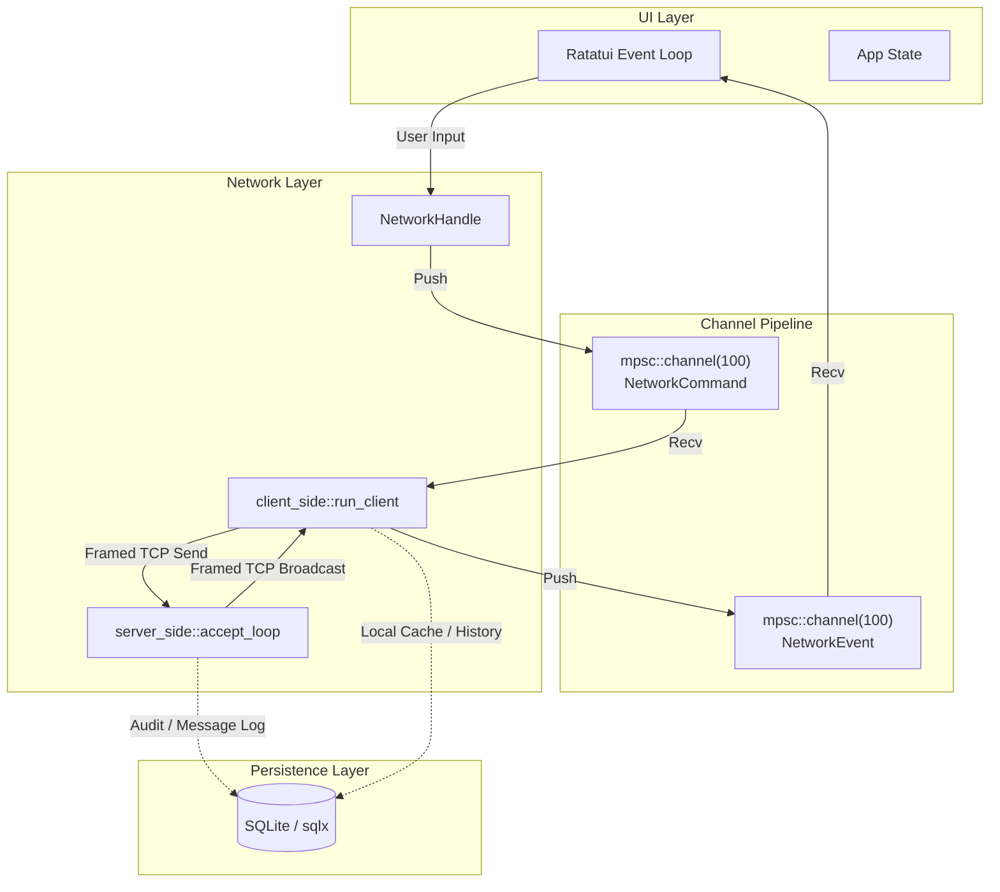

# Alyson — Architecture & Systems Specification

## 1. System Overview
Alyson is a terminal-first, peer-and-room TCP messaging application written in Rust using asynchronous I/O (`tokio`), binary payload framing (`bincode`), terminal UI rendering (`ratatui`, `crossterm`), and local persistent storage (`sqlx`, SQLite).

It supports two runtime operational paradigms:
- **Dev Mode / Integrated Engine**: Spawns an internal TCP server alongside client and TUI event loops within a single process.
- **Distributed Mode**: Standalone dedicated server (`cargo run --bin server -- serve [addr]`) and standalone TUI client (`cargo run --bin client -- connect <addr> --name <username>`).

---

## 2. Directory Layout & Module Responsibilities

```
alyson/
├── Cargo.toml                  # Dependencies: tokio, ratatui, crossterm, bincode, serde, sqlx, thiserror
├── src/
│   ├── lib.rs                  # Crate root, module exports, top-level error definitions
│   ├── main.rs                 # Primary development binary entrypoint (delegates to UI & engine)
│   ├── types.rs                # Core domain entities, wire protocols (ClientRequest, ServerEvent, InboxEntry)
│   ├── db.rs                   # Persistence layer: SqlitePool setup, migrations, CRUD operations
│   ├── bin/
│   │   ├── server.rs           # Dedicated server binary runner
│   │   └── client.rs           # Dedicated standalone client binary runner
│   ├── network/
│   │   ├── mod.rs              # Network engine coordinator, NetworkCommand, NetworkEvent, state structs
│   │   ├── framing.rs          # Length-prefixed binary transport codec (AsyncRead/AsyncWrite)
│   │   ├── server_side.rs      # TCP listener loop, connection handling, client routing & state management
│   │   └── client_side.rs      # Client connection worker, outgoing request routing, incoming event dispatch
│   └── ui/
│       ├── mod.rs              # UI run loop, terminal raw mode hooks, event demuxing
│       ├── app.rs              # UI state machine, active views, focus management, buffers
│       ├── dashboard.rs        # Dashboard widgets and layouts
│       └── ui.rs               # Drawing primitives, panels, error toast renderer
└── tests/
    └── network.rs              # Integration tests for network subsystem
```

---

## 3. Communication & Framing Protocol

### Binary Wire Framing
All network streams use 4-byte big-endian length-prefixed binary encoding over raw TCP:

```
+--------------------------+------------------------------------+
| Length Header (4 Bytes)  | Serialized Payload (Length bytes)  |
| [u32 Big-Endian]         | Bincode-encoded Type               |
+--------------------------+------------------------------------+
```

- **Maximum Allowed Frame Size**: 10 MiB (`MAX_PAYLOAD_SIZE`).
- **Framing Implementation**: [`src/network/framing.rs`](file:///home/mnasie/coding/Rust/alyson/src/network/framing.rs)
  - `read_framed_loop`: Reads exact header length, enforces size cap, reads body buffer, deserializes with `bincode`.
  - `write_framed_loop`: Receives typed instances from an unbounded/bounded channel, serializes via `bincode`, writes length prefix followed by body payload.

### Handshake Sequence
Upon connection establishment:
1. Client transmits a newline-terminated UTF-8 username string (`read_line`).
2. Server validates the username (non-empty check).
3. Server registers the connection, allocates an atomic client ID (`AtomicU64`), and transitions the socket into the binary framed loop.

---

## 4. Message Flow & Channel Architecture



### Core Message Types ([`src/types.rs`](file:///home/mnasie/coding/Rust/alyson/src/types.rs))
- **`ClientRequest`**:
  - `CreateRoom { client_id: u64, username: String }`
  - `JoinRoom { client_id: u64, room_id: u64 }`
  - `ChatMessage(InboxEntry)`
- **`ServerEvent`**:
  - `Welcome { id: usize }`
  - `Roster(Vec<ClientInfo>)`
  - `PeerJoined(ClientInfo)`
  - `ClientDisconnected(u64)`
  - `ChatMessage(InboxEntry)`
  - `RoomCreated(Room)`
  - `RoomJoined { client_id: u64, room: Room }`
  - `Error(String)`
- **`InboxEntry`**: Encapsulates `time` (`SystemTime`), `msg` (`String`), `from` (client ID), `to` (client ID or room ID), and `cli_or_room` routing flag.

---

## 5. State Management & Concurrency Primitives

- **Server-Side Concurrency**:
  - `ServerState`: Protected via `Arc<Mutex<HashMap<u64, Client>>>` and `Arc<Mutex<HashMap<u64, Room>>>`.
  - ID Generators: Lock-free `Arc<AtomicU64>` using `Ordering::SeqCst`.
  - Client Sockets: Independent connection tasks spawned via `tokio::spawn`, maintaining detached write loops.
- **Client-Side Concurrency**:
  - `ClientState`: Encapsulates per-client request sender channels `HashMap<u64, Sender<ClientRequest>>`.
  - Network worker loops yield non-blocking events via Tokio `mpsc` into the synchronous TUI polling cycle.
- **Terminal Crash Protection**:
  - Custom panic hook in `main.rs` and `src/bin/client.rs` immediately restores terminal state (disables raw mode, leaves alternate screen, reveals cursor) before exiting to prevent corrupting the user's shell session on panic.

---

## 6. Persistence Model (`db.rs`)

- **Engine**: SQLite backed by `sqlx` with asynchronous `tokio` runtime.
- **Pooling**: `SqlitePool` with tight connection bounds (default 5 max connections) to prevent SQLite database lock contention.
- **Schema Responsibilities**:
  - Message audit logs (direct & room messages).
  - Room metadata and membership tracking.
  - Client connection and roster history.
