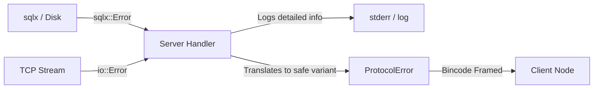

# Alyson Error Architecture Specification

## 1. Overview & Objective
Alyson operates across multiple boundaries: OS syscalls (TCP/socket I/O), application-internal state machines (channels, pools), database storage engines (`sqlx`), and untrusted external peers across a TCP socket stream.

A common anti-pattern is using a single monolithic error enum (like the initial `WireError`) that merges internal runtime faults (`sqlx::Error`, `Arc<io::Error>`) with wire-protocol payloads sent across the network.

---

## 2. Boundary Isolation

Errors must be separated into two distinct categories:

### A. Internal System Errors (`AlysonError`)
Represent errors originating inside the node (server or client host runtime). These are logged locally with full stack/context, but **never serialized directly over the network**:
- `Io(std::io::Error)`: Local disk/network socket syscall errors.
- `Database(sqlx::Error)`: Query execution, pool acquisition, or schema migration failures.
- `ChannelClosed`: Internal Tokio MPSC pipe drops.
- `Framing(bincode::Error)`: Binary decode corruptions.
- `Internal(String)`: Catch-all internal node bugs or unrecoverable invariant violations.

### B. Protocol Wire Errors (`ProtocolError` or wire-safe `WireError`)
Structured, deterministic errors serialized into the binary stream (or delivered via `ServerEvent::Error`):
- `InvalidName`: Rejected handshake due to invalid username syntax/length.
- `PayloadTooLarge`: Exceeded 10 MiB frame quota.
- `ClientNotFound`: Target client does not exist on server.
- `RoomNotFound`: Target room ID does not exist.
- `NotRoomMember`: Attempted to send a message to a room without joining.
- `Unauthorized`: Insufficient permissions for an operation.
- `InternalServerError`: Generic opaque error message to avoid leaking database schema, table names, or internal file paths to untrusted peers.

---

## 3. Propagation & Mapping Flow

### Conversion Rule
Internal errors map to wire errors explicitly:
- Database failure during room creation -> Logs `[ERROR] failed to insert room: {err}` -> Sends `ServerEvent::Error(ProtocolError::InternalServerError)` to client.
- Lookups returning no rows for a room -> Sends `ServerEvent::Error(ProtocolError::RoomNotFound)` to client.
